# DropX App

Aplicación móvil para repartidores del proyecto DropX (mensajería y logística en Cartagena de Indias), desarrollada con Flutter.

## Capturas

| Emulador | Loading | Login | Perfil |
|---|---|---|---|
| 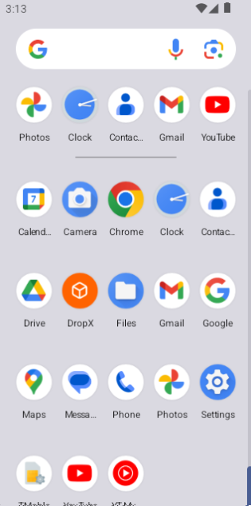 |  | 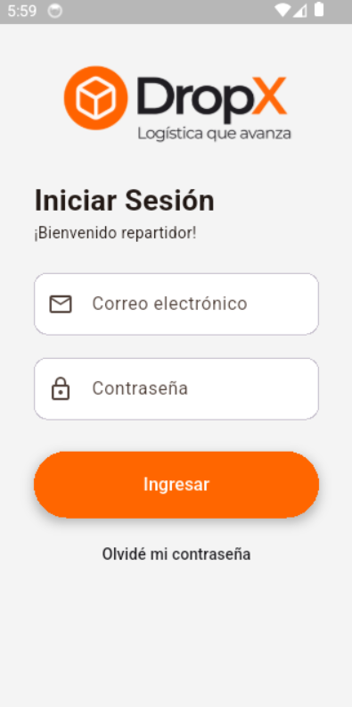 | 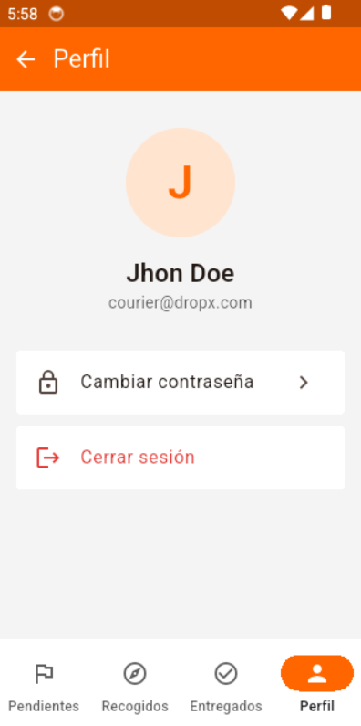 |
| **Pendientes** | **Recogidos** | **Entregados** | **Paquete** |
| 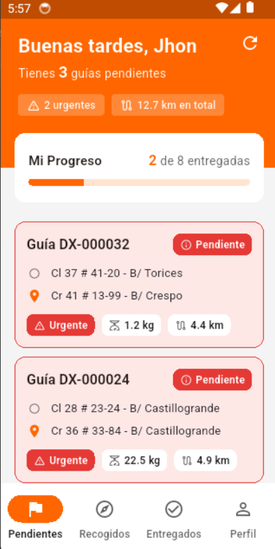 | 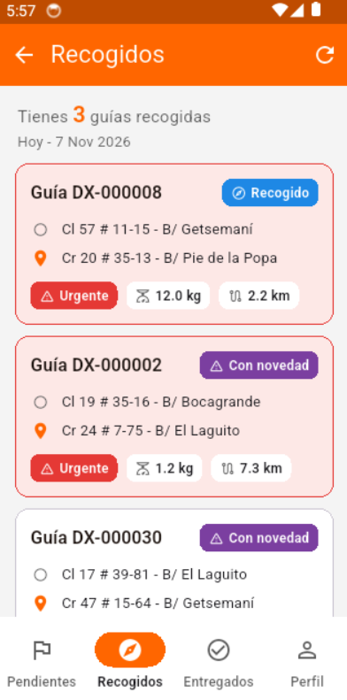 | 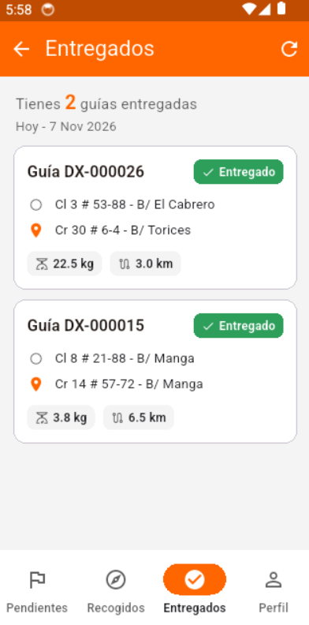 | 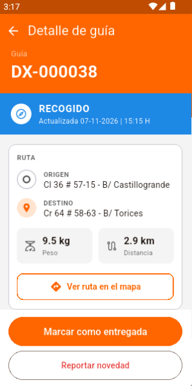 |
| **Navegación** | **Cambio de estado** | **Novedad** | **Entregado** |
| 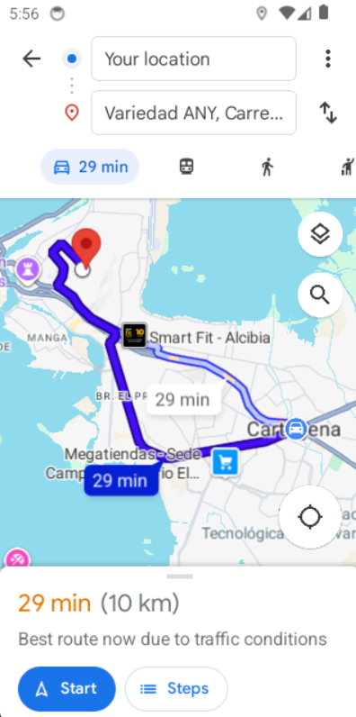 | 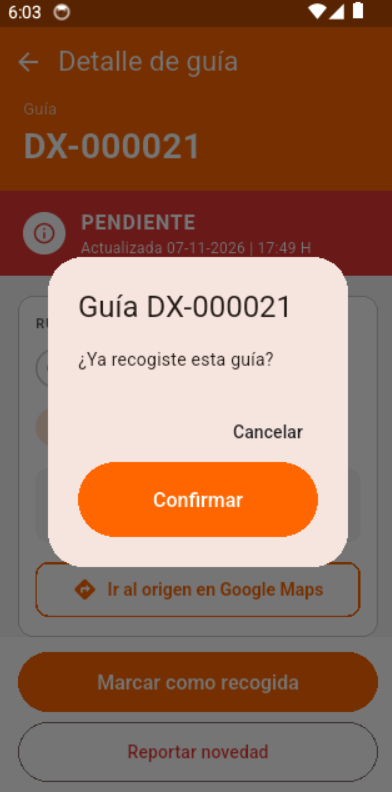 | 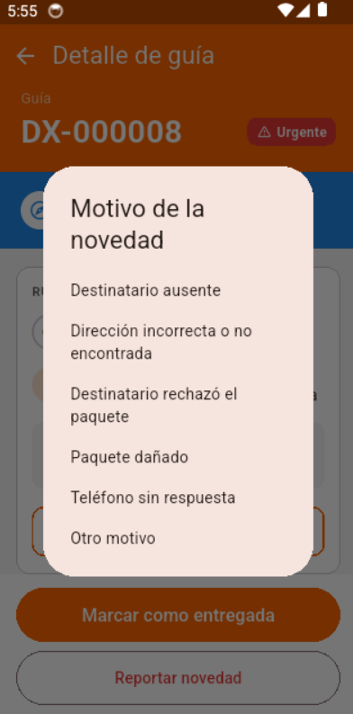 | 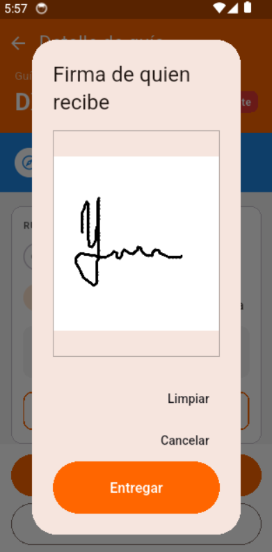 |

## Ejecutar en modo de prueba
**Requisitos:** [Flutter](https://docs.flutter.dev/get-started/install) instalado (Dart 3.13.3 o superior), un emulador o dispositivo conectado y la API de [dropx_web](https://github.com/yammadev/dropx_web) en ejecución con los datos de prueba cargados.

```bash
# Copiar .env
cp .env.example .env

# Instalar requerimientos y encender
flutter pub get
flutter run
```

Para iniciar sesión se usa la cuenta de repartidor `courier@dropx.com` con la clave `SEED_COURIER_PASSWORD` del `.env` de la web.

### Configuración (`.env`)
La configuración está en el archivo `.env` de la raíz (no se sube a GitHub; el modelo es `.env.example`):

| Variable | Descripción | Valor por defecto |
|---|---|---|
| `API_URL` | Dirección de la API | `http://10.0.2.2:5000` |
| `API_TIMEOUT_SECONDS` | Segundos máximos de espera de una respuesta | `15` |

- Emulador de Android: `http://10.0.2.2:5000`.
- Celular real: `http://<IP de la computadora>:5000`, con ambos en la misma red Wi-Fi (la API debe iniciarse con `--host 0.0.0.0`).

Al cambiar el `.env` hay que detener la app y ejecutar `flutter run` de nuevo (un hot reload no lo recarga).

**Recargar las guías:** la app no recibe avisos en tiempo real. Para ver las guías nuevas, se usa el botón de recargar (arriba a la derecha) o deslizar la lista hacia abajo.

**Cambiar el estado de una guía:** en el detalle, los botones de abajo permiten marcarla como recogida o entregada, reportar una novedad o retomar la entrega. Al reportar una novedad se selecciona el motivo de una lista, y al entregar firma quien recibe en pantalla (la firma se ve en el detalle del paquete en la Suite web).

**Ruta en Google Maps:** el botón del detalle abre Google Maps hacia el origen mientras la guía está pendiente por recoger, y hacia el destino cuando ya fue recogida. Usa la ubicación marcada en el mapa al crear el paquete en la Suite; si no tiene, busca por la dirección.

**Si aparece un error de conexión:** el mensaje indica la dirección que usa la app; debe coincidir con la de la API y con el `.env`.

## Producción

La app instalable (APK) se genera con GitHub Actions y se conecta a la API publicada en Render (ver la sección *Producción* de [dropx_web](https://github.com/yammadev/dropx_web)). Cada push a `main` construye el APK firmado y crea una versión nueva en [Releases](https://github.com/yammadev/dropx_app/releases), con los títulos de los commits como notas.

### 1. Dirección de la API

La dirección del servicio de Render aparece arriba en su página (ej: `https://dropx-web.onrender.com`). Para probarla desde el emulador antes de publicar, se pone en el `.env` y se ejecuta `flutter run`:

```
API_URL=https://dropx-web.onrender.com
API_TIMEOUT_SECONDS=60
```

En el plan gratuito de Render el servidor se apaga tras 15 minutos sin uso y tarda cerca de un minuto en encender; por eso la espera es de 60 segundos.

### 2. Llave de firma (una sola vez)

Android solo instala una versión nueva encima de la anterior si las dos están firmadas con la misma llave. Se crea fuera de la carpeta del proyecto, con la herramienta `keytool` que trae Android Studio (pide una contraseña y unos datos; el alias es `upload`):

```powershell
& "C:\Program Files\Android\Android Studio\jbr\bin\keytool.exe" -genkey -v -keystore upload-keystore.jks -keyalg RSA -keysize 2048 -validity 10000 -alias upload
```

Luego se convierte a texto (base64) para guardarlo en GitHub:

```powershell
[Convert]::ToBase64String([IO.File]::ReadAllBytes("upload-keystore.jks")) | Set-Content keystore-base64.txt
```

El archivo `upload-keystore.jks` y su contraseña se guardan en un lugar seguro: si se pierden, el celular no deja actualizar la app y hay que desinstalarla.

### 3. Secretos en GitHub

En el repositorio, **Settings > Secrets and variables > Actions**:

| Tipo | Nombre | Valor |
|---|---|---|
| Variable | `API_URL` | Dirección de la API en Render, sin `/` al final |
| Secreto | `ANDROID_KEYSTORE_BASE64` | El contenido de `keystore-base64.txt` |
| Secreto | `ANDROID_KEYSTORE_PASSWORD` | Contraseña de la llave |
| Secreto | `ANDROID_KEY_PASSWORD` | Contraseña de la llave (la misma, si no se definió otra) |
| Secreto | `ANDROID_KEY_ALIAS` | `upload` |

Para compilar el APK en la computadora (versiones de Flutter, Android SDK y Java, y problemas frecuentes) está la [guía de compilación Android](docs/COMPILACION_ANDROID.md).

### 4. Publicar e instalar

- Cada push a `main` crea una versión; el avance se ve en la pestaña **Actions**. Los cambios que solo tocan archivos `.md` o `docs/` no crean versión. También se puede lanzar a mano desde **Actions > Versión de la app > Run workflow**.
- **Número de versión:** sube solo en el último número (1.3.1, 1.3.2...). Para una versión mayor se cambia `version` en `pubspec.yaml` (ej: `1.4.0+1`) y la siguiente publicación usa ese número.
- **Instalar:** desde el celular se abre la versión en Releases, se descarga `dropx-X.Y.Z.apk` y se abre (Android pide permitir la instalación desde el navegador). Si había una versión instalada con el identificador anterior (`com.example.dropx_app`), se desinstala primero.

## Descripción

Permite al repartidor iniciar sesión, ver sus guías pendientes, recogidas y entregadas,
y consultar el detalle de cada una. Se desarrolla por etapas; el historial de cambios
está en [CHANGELOG.md](CHANGELOG.md).

## Arquitectura (MVVM)
Se utiliza [`provider`](https://pub.dev/packages/provider) para manejar el estado.

- **View** (`lib/views`): interfaz de cada pantalla, sin lógica de negocio.
- **ViewModel** (`lib/viewmodels`): estado y lógica de una pantalla. Extiende `ChangeNotifier`; la vista lo escucha y se redibuja cuando cambia.
- **Model** (`lib/models`): clases de datos.
- **Widgets** (`lib/widgets`): piezas de interfaz reutilizables.
- **Core** (`lib/core`): elementos compartidos, como el tema y los colores.

## Estructura de carpetas

```
dropx_app/
├── .github/
│   └── workflows/
│       └── release.yml   # GitHub Actions: APK firmado y versión nueva en cada push a main
├── android/              # Proyecto nativo Android (identificador com.dropx.app, firma y wrapper de Gradle)
├── ios/                  # Proyecto nativo iOS (generado por Flutter)
├── web/                  # Proyecto web (generado por Flutter)
├── docs/
│   ├── screenshots/      # Capturas del README
│   └── COMPILACION_ANDROID.md  # Guía para compilar el APK en la computadora
├── assets/
│   ├── icon/             # Ícono de la app y logo de la pantalla de carga
│   └── images/           # Imágenes
│       └── logo.png      # Logo
├── lib/
│   ├── core/
│   │   ├── api_config.dart           # Dirección de la API y tiempo de espera
│   │   ├── app_theme.dart            # Colores de la marca y tema global
│   │   ├── links.dart                # Abre páginas de la web (Suite) y Google Maps
│   │   └── package_status_style.dart # Texto, icono y color de cada estado de guía
│   ├── models/
│   │   ├── package_model.dart        # Modelo de guía, su estado y contactos
│   │   └── user_model.dart           # Modelo del repartidor (nombre, correo y rol)
│   ├── viewmodels/
│   │   ├── login_viewmodel.dart      # Estado y lógica del login
│   │   ├── packages_viewmodel.dart   # Listas de guías (cargadas desde la API)
│   │   └── user_viewmodel.dart       # Usuario en sesión y cierre de sesión
│   ├── services/
│   │   └── api_service.dart          # Peticiones a la API y token guardado
│   ├── views/
│   │   ├── home_view.dart            # Home con las 4 pestañas
│   │   ├── login_view.dart           # Pantalla de login (UI)
│   │   ├── package_view.dart         # Detalle de una guía
│   │   └── profile_view.dart         # Pestaña de perfil del repartidor
│   ├── widgets/
│   │   ├── contacts_card.dart        # Tarjeta de contactos del detalle
│   │   ├── detail_card.dart          # Tarjeta con título para las secciones del detalle
│   │   ├── initial_avatar.dart       # Círculo con la inicial del nombre (perfil y contactos)
│   │   ├── package_card.dart         # Tarjeta de una guía
│   │   ├── package_list.dart         # Lista de guías reutilizable
│   │   ├── pending_header.dart       # Encabezado de Pendientes (saludo, resumen y progreso)
│   │   ├── refresh_button.dart       # Botón para recargar las guías
│   │   ├── route_card.dart           # Tarjeta de ruta del detalle (con el botón del mapa)
│   │   ├── signature_dialog.dart     # Ventana para la firma de quien recibe
│   │   ├── status_actions.dart       # Botones para cambiar el estado (motivo de novedad y firma)
│   │   ├── status_band.dart          # Banda de estado del detalle
│   │   └── urgent_badge.dart         # Cajita roja "Urgente" (tarjeta y detalle)
│   └── main.dart                     # Punto de entrada, MaterialApp y Providers
├── .env.example          # Modelo del .env (dirección de la API)
├── CHANGELOG.md          # Historial de cambios
├── pubspec.yaml          # Dependencias y assets
└── README.md             # Documentación
```

> Este árbol se actualiza en cada paso, a medida que se agregan archivos.
